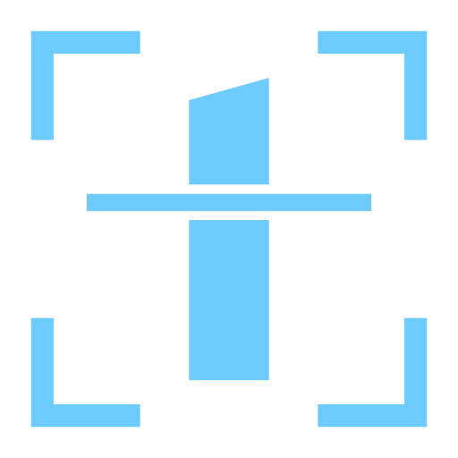
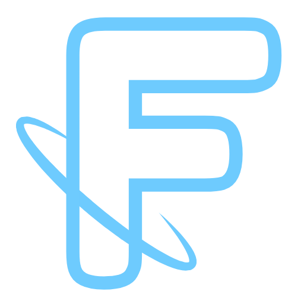

# Frederic G. Fleron Grignard

**Full-Stack Developer · Frontend · Web**

&nbsp;
&nbsp;

**Languages:** English · Spanish · French · Portuguese · German

**Live work:** [Nomi Says](https://nomisays.app) · [IGLY Spatial](https://www.iglyspatial.com) · [ffg-universe](https://www.ffg-universe.com)

**Contact:** [fleron.frederic@gmail.com](mailto:fleron.frederic@gmail.com) · [LinkedIn](https://www.linkedin.com/in/frederic-fleron-grignard)

---

## About Me

Software Engineer and founder of Nomi Says, an AI voice-first language practice companion designed to make language practice feel natural, calm, and conversational.

Originally from Spain and now based in Berlin, my journey has taken me across multiple countries, cultures and industries.

After a successful career transition into software engineering, I balanced intensive study with family life while developing production-ready full-stack applications. That experience sharpened my ability to adapt, prioritize and coordinate multiple demanding responsibilities—qualities I now bring to every technical project I undertake.

My foundation in software engineering is enriched by a diverse background. I am a multilingual communicator (English, Spanish, French, Portuguese and German), a guitarist and composer, a visual artist, a yoga practitioner and an experienced world traveller.

I approach software engineering with the same mindset I bring to raising my children, creating music and pursuing art: precision, patience and a passion for continuous learning.

---

## Featured Projects

&nbsp;
<a href="https://nomisays.app"><strong>Nomi Says — AI Voice-First Language Practice Companion</strong></a>

A production-ready AI web application designed to help people practice speaking languages through calm, natural conversation.

Stack: Next.js · FastAPI · OpenAI · Supabase · Stripe · PostgreSQL

Public site: https://nomisays.app

Status: Public Beta • Early Access

• • •

&nbsp;
<a href="https://github.com/F-Fleron-G/igly-spatial-showcase"><strong>IGLY Spatial — Bilingual Business Website (pro bono)</strong></a>

A premium English and Spanish website for a Miami reality capture company serving hotels and resorts across the Caribbean. I led it end to end, unpaid, as a favor for a friend's business: strategy, design, copywriting, SEO and build.

Features include:

- 28 pages in two languages from shared templates  
- Live 3D tours that load on click  
- Self-filling enquiry form and a booking-commission calculator  
- Lighthouse 99–100 across performance, accessibility, best practices and SEO  

Stack: Astro · TypeScript · Vercel  

Website: https://www.iglyspatial.com · Showcase: https://github.com/F-Fleron-G/igly-spatial-showcase

• • •

&nbsp;
<a href="https://www.ffg-universe.com"><strong>ffg-universe — Interactive Creative Platform</strong></a>

An experimental interactive portfolio combining software engineering, music, writing, and visual art through custom UI interactions.

Features include:

- Orbiting navigation interface  
- Interactive flip-page book component  
- Embedded music demos  
- Contact and commission system  

Stack: React · TypeScript · Tailwind · Vite  

Website: https://www.ffg-universe.com

---

## Technical Skills

| Languages | Frontend & UI | Tooling | Testing | Backend | Database | Platforms & APIs |
|:-------:|:-----------:|:-------------:|:-----:|:--------------:|:------------:|:--------------:|
|  |  |  |  |  |  |  |
|  |  |  |  |  |  |  |
|  |  |  |  |  |  |  |
|  |  |  |  |  |  |  |
|  |  |  |  |  |  |  |
|  |  |  |  |  |  |  |

---

## Professional Values

- Commitment to producing clean, maintainable code
- User-centered approach to design and development
- Adaptability through continuous learning
- Strong project management and time discipline
- Cross-cultural communication and collaboration skills

---

## Personal Interests

- Visual Arts
- Guitar Composition and Music Production
- Yoga and Mindfulness Meditation (Vipassana)
- World Travel and Cultural Studies

---

## Contact

- **Email**: fleron.frederic@gmail.com

---

---

> "Always learning, always building, always moving forward."
